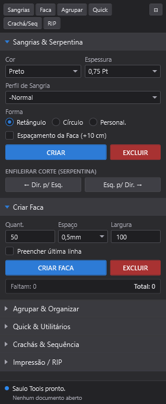
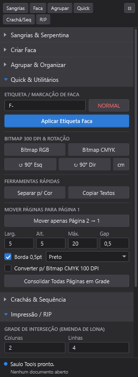

# Saulo Tools — Docker Nativo para CorelDRAW (64-bit)

Janela de Encaixe (*Docker*) nativa para **CorelDRAW 2020 (64-bit)** e versões compatíveis, construída em **C# (.NET Framework 4.7.2/4.8) + WPF + `Corel.Interop.VGCore`**.

Substitui formulários flutuantes legados do VBA (`UserForm`) por um painel único **encaixável, redimensionável, colapsável (estilo acordeão)** e sincronizado automaticamente com o tema do CorelDRAW (Escuro, Preto, Médio e Claro).

## Prévia

| Sangrias & Criar Faca | Quick & Impressão / RIP |
| :---: | :---: |
|  |  |

## Funcionalidades

1. **Sangrias & Serpentina**
   - Perfis de sangria (`-Normal`, `-Perfurado e Envel.`, `-Ilhós`, `-Cavalete`, `-Banners`, `-Faixa`, `-Display_12`, `-Display_6`, `-Lona Rebitada F.`), cores CMYK (`Preto`, `Branco`, `Vermelho`), espessuras (`Esp. Mínima`, `0,5 Pt`, `0,75 Pt`, `1,5 Pt`), formas (`Retângulo`, `Círculo`, `Personal.`), espaçamento de faca (`+10 cm`) e enfileiramento de corte em serpentina (`← Dir. p/ Esq.` e `Esq. p/ Dir. →`).
2. **Criar Faca**
   - Repetição em grade por quantidade, espaçamento (`0,0 mm`, `0,5mm`, `1Cm`), largura máxima (cm), opção de preencher a última linha e contadores dinâmicos (`Faltam` e `Total`).
3. **Agrupar & Organizar**
   - Agrupamento por sobreposição com alinhamento e redimensionamento proporcional (margem 1,5 mm), organização em grade e encaixe inteligente com rotação 90°.
4. **Quick & Utilitários**
   - Etiqueta/marcação de Faca (`NORMAL` / `LAMINADO` com cópia automática para a área de transferência), conversão para Bitmap RGB/CMYK 300 DPI, rotações rápidas `±90°`, unidade em `cm`, separar objetos por cor em camadas, copiar textos de grupos para o clipboard e consolidação de páginas em grade (com borda e bitmap opcionais).
5. **Crachás & Sequência**
   - Redimensionamento 1-clique para crachás **Paisagem (8,6 × 5,5 cm)** e **Retrato (5,5 × 8,6 cm)** e gerador de sequências numéricas ou texto fixo com ajuste proporcional.
6. **Impressão / RIP**
   - Grade de interseção para emenda de lona (cria página `INTERSEÇÃO` com etiquetas `Parte_N` e bordas, ou apenas grade à frente) e algoritmo **Tetris** em prateleiras para aproveitamento de rolo com agrupamento automático.

### Recursos Técnicos
- **Desfazer (`Ctrl+Z`) único** por operação (`BeginCommandGroup` / `EndCommandGroup`);
- **Persistência automática** dos últimos valores usados e seções expandidas em `%APPDATA%\SauloTools\settings.json`;
- **Sem dependência de arquivos `.gms` / VBA**;
- **Sincronização automática** com os temas Claro, Médio, Escuro e Preto do CorelDRAW.

---

## Instalação Rápida (PCs com CorelDRAW 64-bit)

1. Baixe este repositório (ou apenas a pasta [`dist/`](dist/)).
2. **Feche o CorelDRAW**.
3. Execute o instalador no PowerShell (ele faz backup automático da pasta `Workspace` e solicita elevação Administrador para copiar para `Programs64\Addons\SauloTools\`):
   ```powershell
   powershell -ExecutionPolicy Bypass -File ".\dist\install.ps1"
   ```
4. Reabra o CorelDRAW e acesse **Janela → Janelas de encaixe → Saulo Tools** (ou clique no botão **`+`** da barra lateral direita).

Para desinstalar:
```powershell
powershell -ExecutionPolicy Bypass -File ".\dist\uninstall.ps1"
```

---

## Compilação e Testes (Desenvolvimento)

Requisitos: Windows 64-bit, CorelDRAW 2020+ (para `Corel.Interop.VGCore.dll`) e Visual Studio 2022 / Build Tools (`MSBuild`).

```powershell
# 1. Compilar DLL x64 e gerar pacote portátil em dist/
powershell -ExecutionPolicy Bypass -File ".\scripts\build.ps1"

# 2. Validar AppUI.xslt e UserUI.xslt contra o DrawUI.xml real do CorelDRAW
powershell -ExecutionPolicy Bypass -File ".\scripts\verify_xslt.ps1"

# 3. Rodar testes unitários de geometria, persistência e instanciação WPF
powershell -ExecutionPolicy Bypass -File ".\scripts\run_tests.ps1"
```
